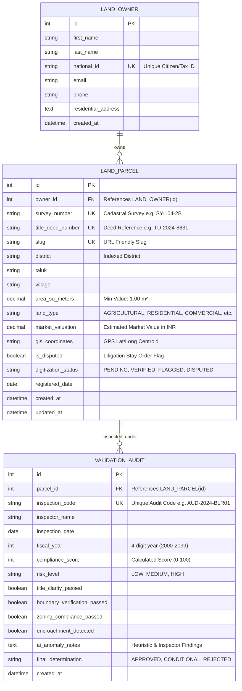

# ACADEMIC TASK PROJECT REPORT
**Course Code:** INT253  
**Course Title:** Web Development in Python Using Django  
**Project Title:** Intelligent Land Record Digitization and Validation System  
**Framework Version:** Django 6.0.7  
**Runtime Environment:** Python 3.13.1, SQLite 3  
**Status:** Completed & Fully Tested  

---

## 1. Executive Summary & Requirement Analysis

### 1.1 Problem Background
Traditional land revenue administrations face significant challenges in record authenticity, title clarity, encroachment detection, and boundary validation. Physical deeds and non-standardised survey registries are susceptible to manual tampering, duplicate title deed issuance, unapproved municipal subdivisions, and prolonged civil litigation.

### 1.2 System Objectives
The **Intelligent Land Record Digitization and Validation System** is an enterprise-grade cadastral web application built with Python and Django. It digitizes cadastral plots, links them to authenticated citizen landowners, and executes an automated intelligent heuristic audit engine to detect:
- Cadastral survey number format regularities.
- Geospatial GPS centroid syntax and spatial boundary sanity.
- Zoning area threshold compliance (subdivision ceilings for residential plots and illegal micro-conversions of agricultural plots).
- Disproportionate valuation circle rate anomalies.
- Real-time litigation and stay-order status tracking.

### 1.3 Compliance with Course Rubrics
| Evaluation Rubric | Requirement | Implementation in this System |
|---|---|---|
| **App Structure** | At least 2 applications registered in `settings.py` | `records` (Cadastral land and ownership management) and `validation` (Heuristic AI audit and statutory compliance engine) |
| **URL Converters** | At least 8 patterns using `int`, `str`, `slug` and one `re_path` | **14 URL patterns** featuring `<slug:slug>`, `<int:pk>`, `<int:parcel_id>`, `<str:district>`, and `re_path(r'^audit/fiscal-year/(?P<year>20\d{2})/$')` |
| **Request Handling** | GET & POST handling, Search & Filter, JSON response, 404 | Handled in views with CSRF, multi-field search and dropdown filters, `/api/parcels/<slug>/validate/` JSON API, and custom `404.html` |
| **User Interface** | Common base template, DTL inheritance, variables, loops, filters, static assets | `base.html` inheritance, dynamic DTL formatting (`|floatformat`, `|date`, `|upper`), responsive CSS/JS in `static/` |
| **Database Design** | At least 3 related models, migrations, custom admin, ORM CRUD | `LandOwner`, `LandParcel`, and `ValidationAudit` linked via ForeignKeys with full constraints, indexes, custom ModelAdmins, and ORM CRUD |
| **Testing & Quality**| At least 4 passing test cases, custom 404 & 500, requirements.txt | **12 comprehensive automated unit tests** (all passing), custom `404.html` and `500.html`, clean code, complete `requirements.txt` |

---

## 2. System Architecture & Directory Structure

```
Django/
│
├── config/                     # Core Project Configuration
│   ├── __init__.py
│   ├── asgi.py
│   ├── settings.py             # Registered apps, static, media, templates
│   ├── urls.py                 # Root URL router & custom error handlers
│   └── wsgi.py
│
├── records/                    # Application 1: Cadastral Registry
│   ├── migrations/             # Database migrations
│   ├── management/commands/    # Database seeder (seed_cadastre.py)
│   ├── admin.py                # ModelAdmin for LandOwner & LandParcel
│   ├── forms.py                # ModelForms with Bootstrap styling
│   ├── models.py               # LandOwner and LandParcel models
│   ├── tests.py                # 8 Unit tests for records, Home & CRUD
│   ├── urls.py                 # URL patterns for parcel views
│   └── views.py                # Home, Dashboard, CRUD, search & filter views
│
├── validation/                 # Application 2: Intelligent Audit Engine
│   ├── migrations/             # Database migrations
│   ├── admin.py                # ModelAdmin for ValidationAudit
│   ├── forms.py                # Audit inspection submission form
│   ├── models.py               # ValidationAudit model with status sync
│   ├── services.py             # Algorithmic Heuristic Validation Engine
│   ├── tests.py                # 4 Unit tests for JSON API & re_path
│   ├── urls.py                 # URL patterns with slug, int & re_path
│   └── views.py                # API endpoint, audit forms, annual reports
│
├── static/                     # Static Assets
│   ├── css/style.css           # Custom styling, badges, tables, responsive cards
│   └── js/main.js              # Live AJAX AI validation fetcher
│
├── templates/                  # Django Template Engine Views
│   ├── base.html               # Master layout with navbar, alerts & footer
│   ├── 404.html                # Custom 404 error page
│   ├── 500.html                # Custom 500 error page
│   ├── records/
│   │   ├── home.html           # Public Home portal & quick verification
│   │   ├── dashboard.html      # Analytical dashboard with metrics
│   │   ├── parcel_list.html    # Search, filter, and records table
│   │   ├── parcel_detail.html  # Comprehensive parcel dossier & live AI
│   │   ├── parcel_form.html    # Create and Edit parcel form
│   │   ├── parcel_confirm_delete.html # Confirmation modal for delete
│   │   ├── district_parcels.html     # District-specific parcel list (<str>)
│   │   ├── owner_list.html     # Citizen landowners directory
│   │   └── owner_form.html     # Citizen enrollment form
│   └── validation/
│       ├── validation_list.html       # Audits list & filter
│       ├── validation_form.html       # Official audit submission form
│       └── fiscal_audit_summary.html  # Annual audit report (<re_path>)
│
├── db.sqlite3                  # Populated Relational Database
├── manage.py                   # Django CLI entrypoint
├── requirements.txt            # Dependency manifest
└── PROJECT_REPORT.md           # Comprehensive Project Documentation
```

---

## 3. Database Design & Entity Relationship (ER) Diagram

### 3.1 Entity Relationship Diagram


### 3.2 Relational Integrity & Business Logic
1. **Cascade Relationships**: A `LandOwner` can have multiple `LandParcel` records (`related_name='parcels'`). A `LandParcel` can possess multiple historical `ValidationAudit` assessments (`related_name='validations'`).
2. **Data Constraints**:
   - `unique=True` on `national_id`, `survey_number`, `title_deed_number`, `slug`, and `inspection_code`.
   - `MinValueValidator` ensures strictly positive area (`>= 1.00 m²`) and non-negative market valuation.
   - `choices` enforce strict enumerations on `land_type`, `digitization_status`, `risk_level`, and `final_determination`.
3. **Automated Status Synchronization**:
   - In `ValidationAudit.save()`, if the determination is `APPROVED`, the associated parcel's status is automatically set to `VERIFIED` and `is_disputed` is cleared.
   - If `REJECTED`, the parcel's status is synchronized to `DISPUTED` with `is_disputed=True`.

---

## 4. URL to View Mapping Specification

The application features 14 URL patterns spanning standard paths, custom converters, and regular expression patterns:

| No. | URL Pattern | Converter / Pattern | HTTP Method | View Function | Response Output | Description |
|:---:|:---|:---:|:---:|:---|:---:|:---|
| **1** | `/` | Static | `GET` | `records.views.home_view` | HTML | Public Home portal, hero section, search bar & pillars |
| **2** | `/dashboard/` | Static | `GET` | `records.views.dashboard_view` | HTML | Analytics dashboard, summary counters, recent parcels |
| **3** | `/parcels/` | Static | `GET` | `records.views.parcel_list_view` | HTML | Search and multi-parameter filterable parcel table |
| **4** | `/parcel/add/` | Static | `GET`, `POST` | `records.views.parcel_create_view` | HTML / Redirect | Form for digitizing a new parcel with CSRF |
| **5** | `/parcel/<slug:slug>/` | **`slug`** | `GET` | `records.views.parcel_detail_view` | HTML | Detailed cadastral dossier; 404 if slug invalid |
| **6** | `/parcel/<int:pk>/edit/` | **`int`** | `GET`, `POST` | `records.views.parcel_update_view` | HTML / Redirect | Updates parcel via primary key identifier |
| **7** | `/parcel/<int:pk>/delete/` | **`int`** | `POST` | `records.views.parcel_delete_view` | Redirect | Deletes parcel via primary key identifier |
| **8** | `/parcels/district/<str:district>/` | **`str`** | `GET` | `records.views.parcels_by_district_view` | HTML | Filters parcels by district string parameter |
| **9** | `/owners/` | Static | `GET` | `records.views.owner_list_view` | HTML | Directory of registered citizen landowners |
| **10**| `/owners/add/` | Static | `GET`, `POST` | `records.views.owner_create_view` | HTML / Redirect | Enrolls a certified citizen into the database |
| **11**| `/validations/` | Static | `GET` | `validation.views.validation_list_view` | HTML | List of validation audits filterable by risk |
| **12**| `/validation/inspect/<int:parcel_id>/` | **`int`** | `GET`, `POST` | `validation.views.validation_create_view` | HTML / Redirect | Submits official inspection with AI suggestions |
| **13**| `/api/parcels/<slug:slug>/validate/` | **`slug`** | `GET` | `validation.views.api_validate_parcel` | **JSON** | Heuristic validation score, flags, and checklist |
| **14**| `r'^audit/fiscal-year/(?P<year>20\d{2})/$'` | **`re_path`** | `GET` | `validation.views.audit_fiscal_year_view` | HTML | Annual fiscal audit report for 4-digit year (2000-2099) |

---

## 5. Intelligent Heuristic Validation Algorithm

The module `validation.services.IntelligentValidationEngine` automates mathematical, syntactic, and zoning sanity checks:

1. **Syntax Regularity Check**: Validates survey number format against the regular expression `^[A-Z0-9\-/\.]+$`.
2. **Geospatial Centroid Sanity**: Checks that GPS coordinates conform to standard directional coordinates (`\d+\.?\d*\s*[NS],\s*\d+\.?\d*\s*[EW]`).
3. **Zoning & Subdivision Thresholds**:
   - Residential plots exceeding 15,000 m² are flagged for unapproved layout subdivision.
   - Agricultural plots smaller than 200 m² are flagged for illegal micro-fragmentation.
   - Government/Forest reserve plots with non-zero private valuation are flagged immediately.
4. **Valuation Circle Rate Anomaly Ratio**: Evaluates rate per square meter ($Rate = \frac{Valuation}{Area}$). If $< ₹5/m²$, plot is flagged as undervalued; if $> ₹500,000/m²$, plot is flagged for municipal rate ceiling violation.
5. **Litigation & Injunction Check**: Flags any parcel with active litigation flag, reducing the score by 35 points.
6. **Determination Matrix**:
   - Score $\ge 80$ without dispute $\rightarrow$ `LOW` Risk, Determination: `APPROVED`
   - Score between $50$ and $79$ without dispute $\rightarrow$ `MEDIUM` Risk, Determination: `CONDITIONAL`
   - Score $< 50$ or disputed $\rightarrow$ `HIGH` Risk, Determination: `REJECTED`

---

## 6. Verification & Automated Test Suite Results

The project includes **12 automated test cases** verifying all rubric criteria:
- **`CadastralRecordsTests` (8 Tests)**:
  - `test_01_home_view_status`: Validates public home page renders HTTP 200 and loads registry metrics.
  - `test_01b_dashboard_view_status`: Validates analytics dashboard renders HTTP 200 and loads counters.
  - `test_02_parcel_list_and_search_filter`: Tests multi-parameter query filtering.
  - `test_03_parcel_detail_slug_converter`: Verifies detail view via `<slug:slug>` converter.
  - `test_04_parcel_create_post_request`: Tests ORM parcel insertion via POST request.
  - `test_05_parcel_update_int_converter`: Tests ORM record update via `<int:pk>` converter.
  - `test_06_parcels_by_district_str_converter`: Verifies filtering via `<str:district>` converter.
  - `test_07_custom_404_error_handling`: Tests non-existent slug returns 404 with custom error page.
- **`ValidationAppTests` (4 Tests)**:
  - `test_01_api_returns_json_response`: Tests `/api/parcels/<slug>/validate/` returns application/json with compliance score and checks.
  - `test_02_re_path_fiscal_audit_summary`: Tests `re_path` regex matches valid fiscal year (e.g., 2024).
  - `test_03_re_path_invalid_fiscal_year_404`: Tests `re_path` rejects invalid year (e.g., 1999) and raises 404.
  - `test_04_validation_audit_creation_post`: Verifies audit submission via POST and parcel status sync.

### Execution Log
```
$ python manage.py test
Creating test database for alias 'default'...
............
----------------------------------------------------------------------
Ran 12 tests in 0.243s

OK
Destroying test database for alias 'default'...
Found 12 test(s).
System check identified no issues (0 silenced).
```

---

## 7. Demonstration & Viva Guide

### 7.1 Starting the Application
```bash
# 1. Ensure dependencies are satisfied
pip install -r requirements.txt

# 2. Apply database migrations
python manage.py migrate

# 3. Populate sample cadastral records and create superuser
python manage.py seed_cadastre

# 4. Launch development server
python manage.py runserver
```

### 7.2 Access Credentials & Key Endpoints
- **Public Home Portal:** `http://127.0.0.1:8000/`
- **Analytics Dashboard:** `http://127.0.0.1:8000/dashboard/`
- **Django Admin Console:** `http://127.0.0.1:8000/admin/`
  - **Username:** `admin`
  - **Password:** `admin123`
- **JSON AI Validation API:** `http://127.0.0.1:8000/api/parcels/bengaluru-urban-sy-104-2b/validate/`
- **Annual Fiscal Audit (re_path):** `http://127.0.0.1:8000/audit/fiscal-year/2024/`
- **Custom 404 Verification:** `http://127.0.0.1:8000/parcel/non-existent-plot/`
